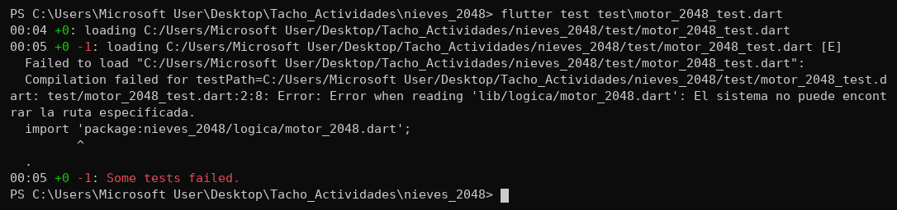
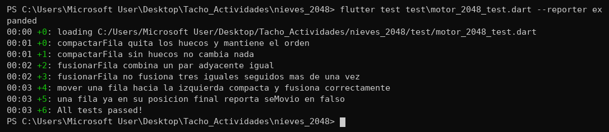
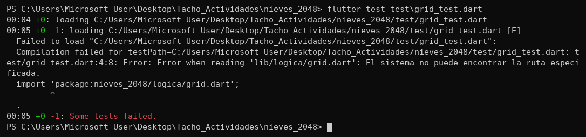
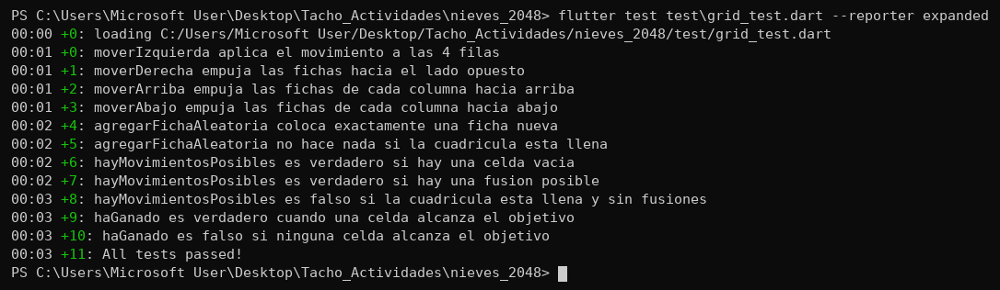
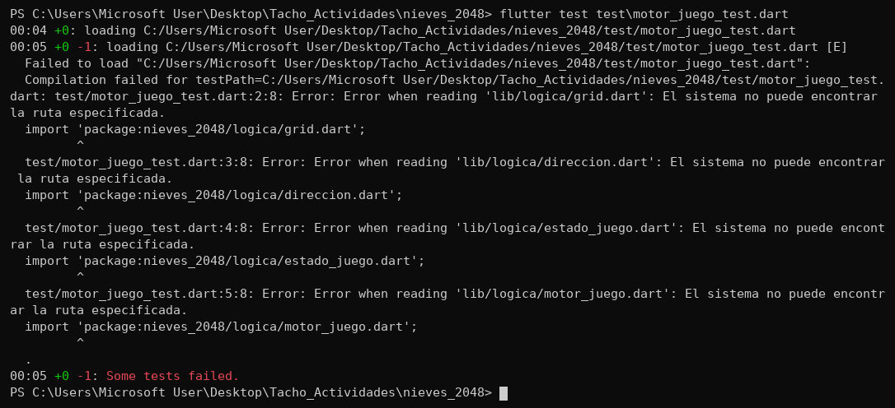
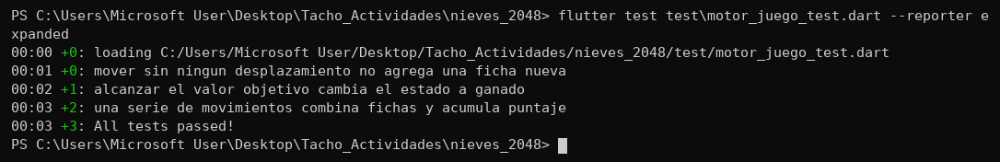
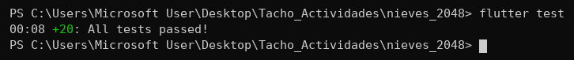

# Nieves 2048 — Un juego de fusión construido 100% con TDD

Clon del famoso juego **2048** hecho en **Flutter** con **TDD (Rojo → Verde → Refactor)**, donde cada
número es un sabor de nieve de Dolores Hidalgo. La ficha final, 2048, es **¡Independencia!**

- **Materia:** Desarrollo Móvil Integral — UTNG
- **Profesor:** Anastacio Rodríguez García

---

## Los 11 sabores

| Valor | Sabor | Valor | Sabor |
|---|---|---|---|
| 2 | Vainilla | 128 | Mole |
| 4 | Fresa | 256 | Tequila |
| 8 | Chocolate | 512 | Café |
| 16 | Mango | 1024 | Rompope |
| 32 | Limón | **2048** | **¡Independencia!** |
| 64 | Uva | | |

## Reglas

- Al deslizar, todas las fichas se mueven hacia ese lado hasta topar con el borde o con otra ficha.
- Dos fichas iguales que chocan se fusionan en una con el doble de valor (una sola vez por movimiento).
- Después de cada movimiento que sí desplazó algo, aparece una nieve nueva (90 % Vainilla, 10 % Fresa).
- Se gana al formar **¡Independencia!** (2048). Se pierde cuando la cuadrícula está llena y no hay movimientos.

---

## Estructura del proyecto

```
nieves_2048/
├─ lib/
│  ├─ logica/                 Dart puro (sin Flutter)
│  │  ├─ motor_2048.dart      compactar, fusionar y mover una fila
│  │  ├─ grid.dart            la cuadrícula 4x4: 4 direcciones, ficha al azar, victoria/derrota
│  │  ├─ direccion.dart
│  │  ├─ estado_juego.dart
│  │  └─ motor_juego.dart     orquesta todo: puntaje, estado, fichas nuevas
│  ├─ presentation/
│  │  └─ juego_screen.dart    fichas con degradados y animaciones
│  └─ main.dart
├─ test/
│  ├─ motor_2048_test.dart    (6 pruebas)
│  ├─ grid_test.dart          (11 pruebas)
│  └─ motor_juego_test.dart   (3 pruebas)
├─ capturas/                  evidencias del ciclo rojo / verde
├─ paso1_ROJO.ps1
├─ paso2_VERDE.ps1
└─ pubspec.yaml
```

**20 pruebas en total.** No usa paquetes externos.

---

## Cómo ejecutarlo

En PowerShell, dentro de la carpeta `nieves_2048`:

```powershell
flutter create .
Remove-Item test\widget_test.dart
flutter pub get
flutter test
flutter run -d edge
```

En el navegador se juega arrastrando con el mouse sobre la cuadrícula. En el emulador o celular,
deslizando el dedo (`flutter run -d emulator-5554`).

---

## Ciclo TDD — Evidencias

🔴 **ROJO:** se escribe la prueba primero; falla porque el código todavía no existe.
🟢 **VERDE:** se escribe el código mínimo para que la prueba pase.
🔵 **REFACTOR:** se ordena el código sin romper las pruebas.

### 1. Motor de una fila (Rondas 1–3)
**🔴 Rojo**



**🟢 Verde**



### 2. Cuadrícula (Rondas 4–9)
**🔴 Rojo**



**🟢 Verde**



### 3. Motor del juego (Ronda 10 + integración)
**🔴 Rojo**



**🟢 Verde**



### 4. Todas las pruebas


---

## Checklist

- [x] `compactarFila` y `fusionarFila` se probaron por separado antes de combinarse en `moverFilaIzquierda`.
- [x] Existe una prueba específica para tres fichas iguales seguidas (no se fusionan dos veces).
- [x] `moverDerecha`, `moverArriba` y `moverAbajo` reutilizan `moverIzquierda` en vez de duplicar el algoritmo.
- [x] `agregarFichaAleatoria` acepta un `Random` inyectado para pruebas deterministas.
- [x] `MotorJuego` agrega una ficha nueva solo si el movimiento realmente desplazó algo.
- [x] La interfaz no reimplementa ninguna regla del juego: solo traduce gestos y dibuja el estado.
